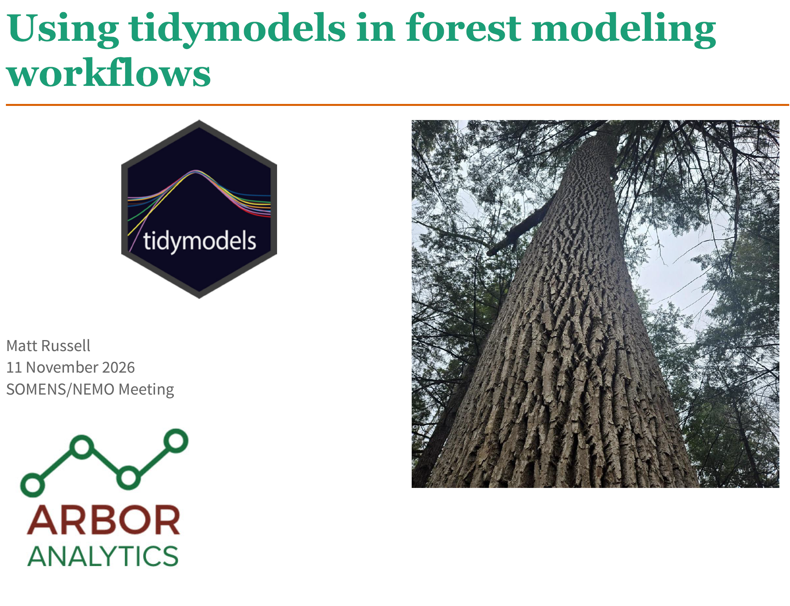

# Using tidymodels in forest modeling workflows

This repository contains exercises, solutions, and datasets for *Using tidymodels in forest modeling workflows* workshop. Delivered on 11 November 2026 at the Northeastern/Southern Mensurationists (NEMO/SOMENS) Annual Meeting. 

Contact: Matt Russell: [matt@arbor-analytics.com](mailto:matt@arbor-analytics.com).

